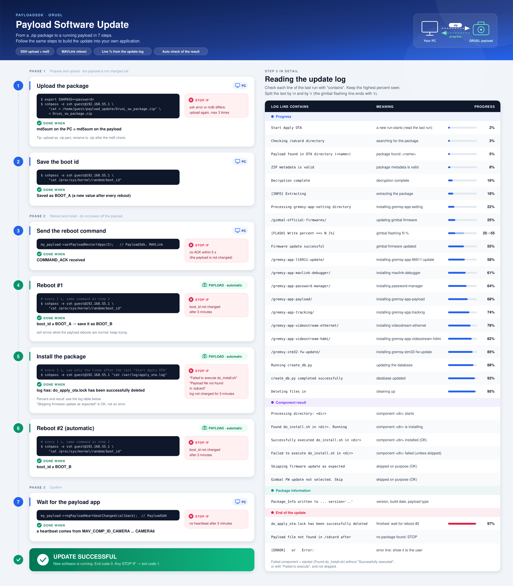

# Update Payload Package

Upload a software package to the payload, reboot it and follow the update until the payload app is running again.

Supported payload: ORUSL.



## Requirements

```
sudo apt-get install sshpass openssh-client
```

You also need the SSH password of the `guest` user on the payload.

## Build

From the root of PayloadSdk:
```
mkdir build && cd build
cmake -DORUSL=ON ..
make -j$(nproc) payload_updater
```

## Run

```
./tests/update_payload_package/payload_updater [path/to/package.zip]
```

Enter the SSH password and the package path when asked. Do not power off the payload during the update.

The program:
1. Uploads the package to `/home/guest/payload_update` and checks its MD5.
2. Reboots the payload. The payload installs the package by itself and reboots again.
3. Waits until the payload app is running and prints the result.

Example:
```
[1/5] Checking the package
  ✔ OrusL_sw_package.zip  (147.8 MB)

[2/5] Uploading the package to the payload
  ✔ Logged in to guest@192.168.55.1
  ✔ Uploaded 147.8 MB in 13s  (11.2 MB/s), md5 verified

[3/5] Rebooting the payload
  ✔ Connected to the payload app
  ✔ Reboot command accepted

[4/5] Applying the update (do not power off the payload)
  ✔ Rebooting the payload
  ✔ Starting Apply OTA
  ✔ Installing gremsy-app-setting
  ✔ Skipping gimbal-official-firmwares (not selected)
  ✔ Installing gremsy-app-payload
  ✔ Apply OTA finished
  ✔ Rebooting the payload (automatic)

[5/5] Starting the payload app
  ✔ Starting the payload app

┌──────────────────────────────────────────────────────────────────┐
│ ✔ UPDATE SUCCESSFUL                                              │
├──────────────────────────────────────────────────────────────────┤
│ Package        OrusL_sw_package.zip                              │
│ Version        v307.59.13  (build 2026-10-28, Payload-ORUSL)     │
│ Components     9/10 installed, gimbal-official-firmwares skipped │
└──────────────────────────────────────────────────────────────────┘
```

The exit code is `0` on success and `1` on failure. If the update fails before the reboot (wrong password, network error, invalid file), the payload is not changed.

## Configuration

| Setting | File | Default |
|---|---|---|
| Payload IP | `libs/payloadsdk.h` (`udp_ip_target`) | `192.168.55.1` |
| SSH user, upload folder | `main.cpp` (`PAYLOAD_SSH_USER`, `PAYLOAD_UPDATE_DIR`) | `guest`, `/home/guest/payload_update` |
| Timeouts | `ota_monitor.h` | 180 s |

Rebuild after changing these values.

The SSH host key is not checked, so use the tool on a trusted network only.
